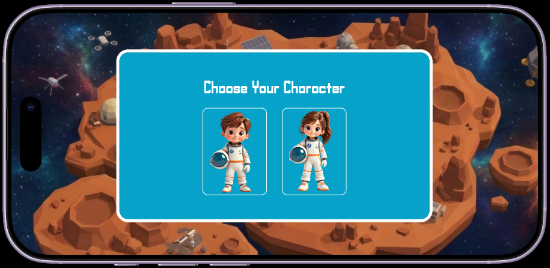
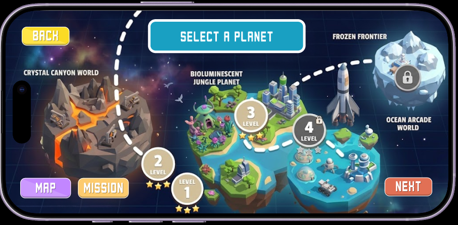
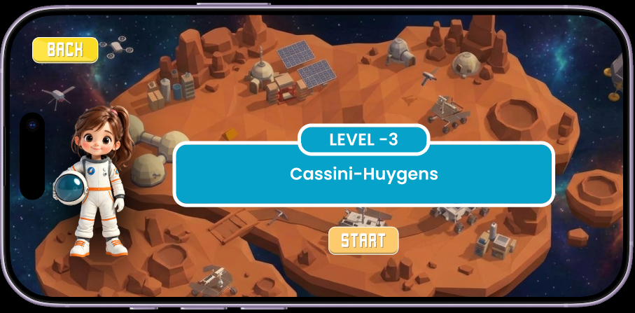
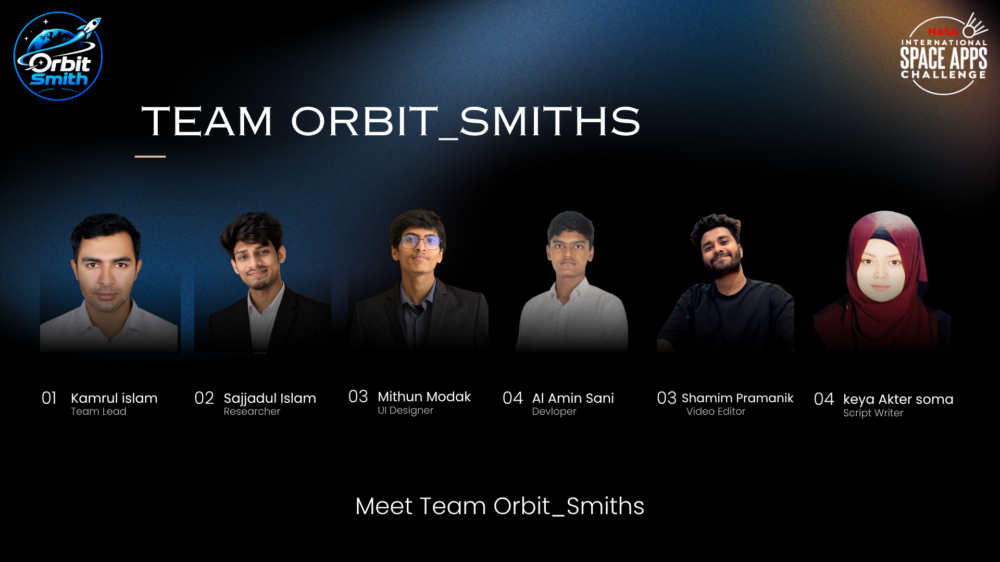

<!-- ANIMATED SPACE HEADER -->
<div align="center">
  

  

  <h3>🚀 Team Orbit Smiths Presents — NASA Space Apps Challenge 2026</h3>

  <!-- ANIMATED TYPING SUBTITLE -->
  <a href="https://www.figma.com/proto/OkwNxRuUFlf88F82MKg0HP/Nasa-space-app-challenge-2026?node-id=48-3&scaling=scale-down&content-scaling=fixed&page-id=0%3A1&starting-point-node-id=3%3A6">
    
  </a>

  <br />

  <!-- PRIMARY ACTION BADGES -->
  <p>
    <a href="https://www.figma.com/proto/OkwNxRuUFlf88F82MKg0HP/Nasa-space-app-challenge-2026?node-id=48-3&scaling=scale-down&content-scaling=fixed&page-id=0%3A1&starting-point-node-id=3%3A6">
      
    </a>
    <a href="docs/presentation/ASTROMIND-240-Second-Script.pdf">
      
    </a>
    <a href="https://www.spaceappschallenge.org/">
      
    </a>
    <a href="docs/PROTOTYPE_AND_UX.md">
      
    </a>
  </p>

  <!-- QUICK NAVIGATION BAR -->
  <p>
    <a href="#-at-a-glance">⚡ At a Glance</a> •
    <a href="#-mission-chapters">🪐 Mission Chapters</a> •
    <a href="#-prototype-gallery">📸 Prototype Gallery</a> •
    <a href="#-getting-started">🚀 Quick Start</a> •
    <a href="#-240-second-pitch-story">🎬 Pitch Story</a> •
    <a href="#-team-orbit-smiths">👩‍🚀 Team</a>
  </p>

  <br />

  <!-- HERO START SCREEN PREVIEW -->
  
  <br />
  <sub><em>Original ASTROMIND Start Screen designed in Figma by Team Orbit Smiths</em></sub>
</div>

---

## ⚡ At a Glance

> **Imagine a robot millions of kilometres from Earth. Its wheels stop, its signal fades — but the discoveries it made live on.**

<table>
  <tr>
    <td width="33%" valign="top">
      <h3>🎯 The Challenge</h3>
      <p><strong>Abandoned but Not Forgotten:</strong> Storytelling about NASA's discarded equipment on the Moon and Mars. Historic mission facts are often buried in dense technical archives.</p>
    </td>
    <td width="33%" valign="top">
      <h3>💡 Our Solution</h3>
      <p><strong>ASTROMIND</strong> turns space history into an illustrated, interactive adventure where young learners pick an astronaut, visit historic hardware, and complete discovery quizzes.</p>
    </td>
    <td width="33%" valign="top">
      <h3>📦 What's Inside Today</h3>
      <p>An interactive <strong>Figma prototype</strong>, a standalone <strong>HTML/CSS/JS showcase</strong>, verified NASA research references, and our <strong>240-second pitch script</strong>.<br /><sub><em>(Not a published mobile store app; no live NASA API connected yet.)</em></sub></p>
    </td>
  </tr>
</table>

---

## 🌌 Why ASTROMIND?

For decades, NASA's robotic and crewed explorers—such as the **Apollo Lunar Roving Vehicles**, **Sojourner**, and **Opportunity**—have transformed our understanding of the Moon and Mars. Yet for school-age students, these incredible stories are scattered across isolated mission logs, historical photographs, and technical reports.

**ASTROMIND** bridges that gap by transforming passive reading into active exploration:

| Icon | Core Experience | How It Helps Learners |
| :---: | :--- | :--- |
| 🧑‍🚀 | **Astronaut Selection** | Gives students a personal role and agency inside the adventure |
| 🗺️ | **Moon & Mars Mission Map** | Places each spacecraft in its real planetary and geographical context |
| 🚀 | **Interactive Storytelling** | Explains what each machine did, why it was built that way, and what it found |
| 📷 | **Authentic NASA References** | Connects illustrated storytelling to real mission photography and science |
| 🧠 | **Discovery Quizzes** | Reinforces key takeaways with instant, educational explanations |
| 🌟 | **Mission Legacy** | Shows how silent machines continue to inspire future planetary missions |

> *Features above represent the team's design concept. Open the [Figma prototype](https://www.figma.com/proto/OkwNxRuUFlf88F82MKg0HP/Nasa-space-app-challenge-2026?node-id=48-3&scaling=scale-down&content-scaling=fixed&page-id=0%3A1&starting-point-node-id=3%3A6) to experience the currently linked screens and interactions.*

---

## 🪐 Mission Chapters

ASTROMIND guides learners through three iconic chapters of human and robotic exploration:

| Chapter | Explorer & World | Operational Legacy | Core Learning Question | Official NASA Source |
| :--- | :--- | :--- | :--- | :--- |
| **🌕 Chapter 1** | **Apollo Lunar Roving Vehicle**<br />*(The Moon)* | Extended astronauts' reach far beyond the lunar landing sites for distant geological fieldwork. | *Why was mobility such a game-changer for scientific fieldwork on the Moon?* | [NASA Apollo 17](https://www.nasa.gov/mission/apollo-17/) |
| **🔴 Chapter 2** | **Sojourner Rover**<br />*(Mars Pathfinder)* | The first wheeled rover to operate on Mars, proving mobile robots could investigate alien terrain. | *What changes when a spacecraft can drive rather than stay in one place?* | [NASA Mars Pathfinder](https://science.nasa.gov/mission/mars-pathfinder/) |
| **🟠 Chapter 3** | **Opportunity Rover**<br />*(Mars Exploration)* | Built for **90 Martian days**, explored for nearly **15 years**, and uncovered key evidence of ancient water. | *What did Opportunity teach scientists about water on ancient Mars?* | [NASA Opportunity](https://science.nasa.gov/mission/mer-opportunity/) |

### 🧠 The Knowledge Challenge
At the end of each chapter, learners answer interactive questions focused not on rote memorization, but on understanding **why each mission mattered** to science and future exploration.

---

## 📸 Prototype Gallery

> **Note on Visuals:** The hero start screen at the top of this page is an original design from Team Orbit Smiths. The seven numbered frames below are **labeled placeholders** (`1600 × 900 px`, 16:9) prepared for your horizontal Figma exports. Replace them following the **[Screenshot Replacement Guide](docs/SCREENSHOT_GUIDE.md)** before final submission.

<table>
  <tr>
    <td width="50%" align="center" valign="top">
      
      <p><strong>01 · Choose Your Astronaut</strong><br /><sub>Begin the adventure by selecting a playable character.</sub></p>
    </td>
    <td width="50%" align="center" valign="top">
      
      <p><strong>02 · Select the Mission</strong><br /><sub>Pick Moon or Mars to uncover hardware left behind.</sub></p>
    </td>
  </tr>
  <tr>
    <td width="50%" align="center" valign="top">
      
      <p><strong>03 · Apollo — Exploring the Moon</strong><br /><sub>Meet the Lunar Roving Vehicle that expanded astronaut range.</sub></p>
    </td>
    <td width="50%" align="center" valign="top">
      
      <p><strong>04 · Sojourner — First Wheels on Mars</strong><br /><sub>Discover the pioneer rover of mobile robotic exploration.</sub></p>
    </td>
  </tr>
  <tr>
    <td width="50%" align="center" valign="top">
      
      <p><strong>05 · Opportunity — The Long Journey</strong><br /><sub>Follow a 90-sol mission that lasted nearly 15 years.</sub></p>
    </td>
    <td width="50%" align="center" valign="top">
      
      <p><strong>06 · Mission Quiz</strong><br /><sub>Connect mission engineering with real scientific discoveries.</sub></p>
    </td>
  </tr>
  <tr>
    <td colspan="2" align="center" valign="top">
      
      <p><strong>07 · Quiz Feedback & Mission Legacy</strong><br /><sub>Reinforce learning with concise explanations and end-of-level takeaways.</sub></p>
    </td>
  </tr>
</table>

---

## 🚀 Getting Started

<table>
  <tr>
    <td width="50%" valign="top">
      <h3>Option A · Play in Figma (Recommended)</h3>
      <p><em>No installation, Python server, or API keys required.</em></p>
      <ol>
        <li>Open the <a href="https://www.figma.com/proto/OkwNxRuUFlf88F82MKg0HP/Nasa-space-app-challenge-2026?node-id=48-3&scaling=scale-down&content-scaling=fixed&page-id=0%3A1&starting-point-node-id=3%3A6"><strong>ASTROMIND Figma Prototype</strong></a>.</li>
        <li>Click through the start screen to pick your astronaut.</li>
        <li>Explore the available mission chapters and interactive quiz flows.</li>
      </ol>
    </td>
    <td width="50%" valign="top">
      <h3>Option B · Run Web Showcase Locally</h3>
      <p><em>Includes an informational site (<code>index.html</code>) & sample quiz for GitHub Pages.</em></p>

```bash
python -m http.server 8000
```

  <p>Open <strong>http://localhost:8000/</strong> in your browser, or deploy via <strong>GitHub Settings → Pages → Deploy from branch (<code>main</code> / root)</strong>.</p>
    </td>
  </tr>
</table>

---

## 🛠️ Tools, Tech Stack & Future API Plan

| Technology / Resource | Role in ASTROMIND |
| :--- | :--- |
|  | Designing and prototyping the interactive ASTROMIND adventure |
|  | Lightweight companion showcase and illustrative quiz for GitHub Pages |
|  | Version control, automated validation workflows, and documentation |
|  | Optional local preview server & repository validation script |
| **NASA Public Archives** | Primary historical and scientific research for Apollo, Sojourner, and Opportunity |

> **🔭 Future NASA API Roadmap:** NASA Image and Video Library, Moon/Mars Trek WMTS services, and the Planetary Data System (PDS) are planned as **future integration candidates**, not live features in the current prototype. See **[docs/API_PLAN.md](docs/API_PLAN.md)** for full details.

---

## 🎬 240-Second Pitch Story

Our presentation script is structured into four narrative acts:

| Timestamp | Narrative Arc | Key Message |
| :--- | :--- | :--- |
| **0:00 – 0:45** | **WHO** | A rover goes silent on an alien world; Team Orbit Smiths introduces **ASTROMIND**. |
| **0:45 – 1:45** | **WHY** | Young learners struggle with fragmented, overly technical space-mission archives. |
| **1:45 – 2:45** | **WHAT** | Astronaut selection, interactive Moon/Mars exploration, NASA references, and quizzes. |
| **2:45 – 4:00** | **SO WHAT NEXT** | Classroom impact, accessibility goals, and future live NASA API integrations. |

📄 **[Download / Read the Complete 240-Second Pitch Script (PDF)](docs/presentation/ASTROMIND-240-Second-Script.pdf)**

---

## 👩‍🚀 Team Orbit Smiths

Six multidisciplinary contributors bringing research, UI/UX design, development, video production, and storytelling together:

<div align="center">
  
</div>

<br />

| Team Member | Role & Contribution |
| :--- | :--- |
| **Kamrul Islam** | Team Lead |
| **Sajidul Islam** | Researcher |
| **Mithun Modok** | UI Designer |
| **Al Amin Sani** | Developer |
| **Shamim Paramanik** | Video Editor |
| **Keya Akter** | Script Writer |

<sub><em>*Name spellings follow the 240-second presentation script where they differ from the team poster. See <a href="docs/TEAM.md">docs/TEAM.md</a> prior to final submission.</em></sub>

---

## 🎓 Educational Goals

- **Approachable Space History:** Make landmark Moon and Mars missions engaging for school-age learners.
- **Engineering Meets Science:** Show how rover mobility and design directly enabled major planetary discoveries.
- **Curiosity Over Memorization:** Encourage students to ask *why* missions mattered rather than just memorizing dates.
- **Enduring Legacy:** Illustrate how completed missions pave the way for Artemis and future Mars exploration.

<sub><em>Planned evaluation: Classroom usability testing and accessibility enhancements are future milestones, not completed studies.</em></sub>

---

<details>
<summary><strong>🗂️ Click to View Repository Structure, Credits & Scope Notes</strong></summary>

<br />

### Repository Layout
```text
ASTROMIND-2026-Voyagers-Inspired/
├── README.md                          # Main project presentation
├── assets/
│   ├── icons/orbit-mark.svg           # Team Orbit Smiths emblem
│   ├── images/
│   │   ├── astromind-start-screen.png # Original Figma start screen
│   │   └── orbit-smiths-team.png      # Original team poster
│   └── screenshots/                   # 01–07 horizontal Figma prototype screens
├── docs/
│   ├── presentation/ASTROMIND-240-Second-Script.pdf
│   ├── PROTOTYPE_AND_UX.md
│   ├── API_PLAN.md
│   ├── SCREENSHOT_GUIDE.md
│   ├── ASSET_CREDITS.md
│   ├── SOURCES.md
│   └── TEAM.md
├── index.html                         # GitHub Pages static showcase
├── styles/site.css
├── scripts/site.js
├── scripts/validate_repo.py
├── .github/workflows/validate.yml
└── PUSH_NEW_REPOSITORY.ps1
```

### Contributing, Credits & Project Scope
- **Contributing:** Usability feedback and factual improvements are welcome via [CONTRIBUTING.md](CONTRIBUTING.md).
- **Attribution:** See [docs/ASSET_CREDITS.md](docs/ASSET_CREDITS.md) and [docs/SOURCES.md](docs/SOURCES.md) for full asset and NASA archive credits.
- **Scope & License:** This is an independent NASA Space Apps Challenge 2026 student project; NASA's name and marks do not imply endorsement. The repository's MIT license applies to original companion-site code and does not relicense team portraits, Figma artwork, or third-party mission imagery.
- **Documentation Inspiration:** Repository structure takes inspiration from the public [Aqua Explorer README by Team Voyagers](https://github.com/sajibmalek/aqua-explorer); all ASTROMIND writing, visuals, and project claims are separately authored.

</details>

---

<!-- ANIMATED SPACE FOOTER -->
<div align="center">
  <a href="https://www.figma.com/proto/OkwNxRuUFlf88F82MKg0HP/Nasa-space-app-challenge-2026?node-id=48-3&scaling=scale-down&content-scaling=fixed&page-id=0%3A1&starting-point-node-id=3%3A6">
    
  </a>

  
</div>