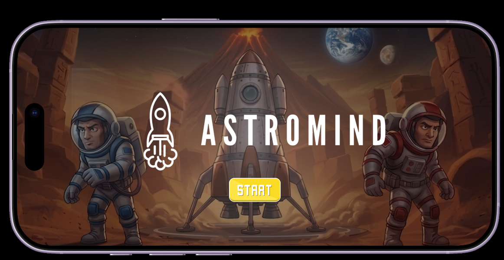
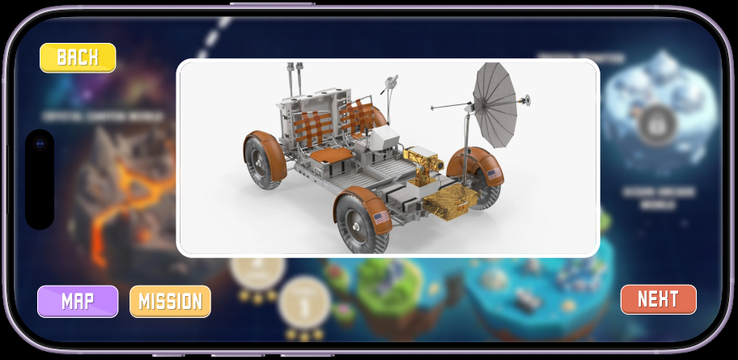
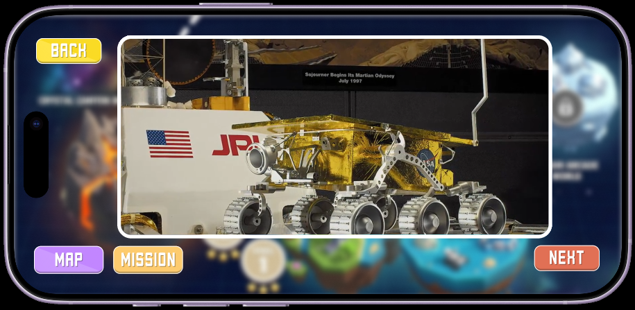
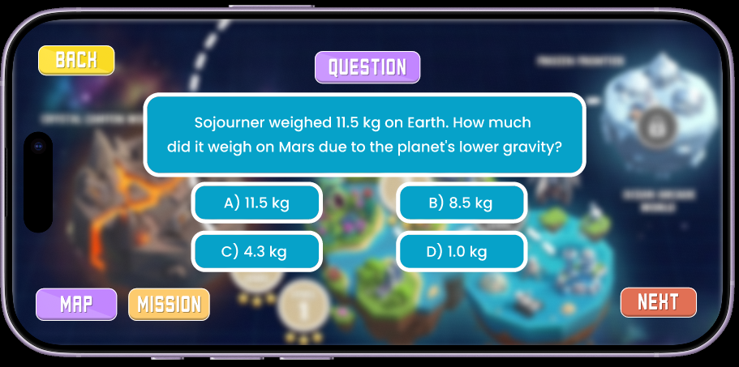
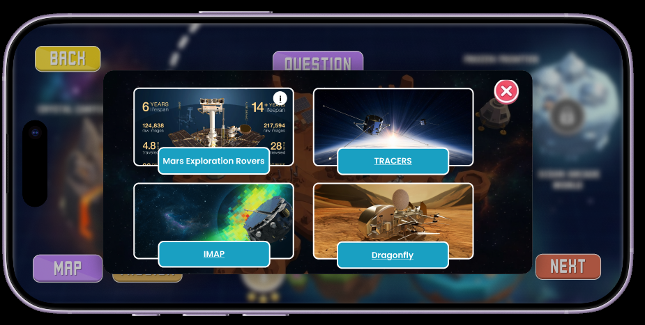

<div align="center">


# ASTROMIND

### Team Orbit Smiths presents **ASTROMIND** — Every Machine Has a Story

*A NASA Space Apps Challenge 2026 educational adventure about the legacies of Moon and Mars explorers.*

[](https://www.figma.com/proto/OkwNxRuUFlf88F82MKg0HP/Nasa-space-app-challenge-2026?node-id=48-3&scaling=scale-down&content-scaling=fixed&page-id=0%3A1&starting-point-node-id=3%3A6)
[](https://www.spaceappschallenge.org/)
[](docs/PROTOTYPE_AND_UX.md)

[**Play the Figma prototype**](https://www.figma.com/proto/OkwNxRuUFlf88F82MKg0HP/Nasa-space-app-challenge-2026?node-id=48-3&scaling=scale-down&content-scaling=fixed&page-id=0%3A1&starting-point-node-id=3%3A6) · [**Read the project story**](#-project-story) · [**Read the pitch script**](docs/presentation/ASTROMIND-240-Second-Script.pdf)



**ASTROMIND · Every machine has a story. Every discovery has a legacy.**

</div>

---

## 🌌 Introduction

> Imagine a robot millions of kilometres from Earth. Its wheels stop, its signal fades — but the discoveries it made live on.

For decades, NASA's robotic and crewed explorers have transformed our understanding of the Moon and Mars. The **Apollo Lunar Roving Vehicles**, **Sojourner**, and **Opportunity** each opened a new chapter of planetary science. Their adventures and scientific achievements, however, are spread across mission archives, historical photographs, and technical reports.

**ASTROMIND** brings these stories closer to young learners through an illustrated, interactive educational adventure. Instead of only reading mission facts, students can **select an astronaut, explore the Moon or Mars, encounter historic machines, and answer quizzes** that reinforce what they've learned.

**Challenge:** *Abandoned but Not Forgotten: Storytelling about NASA's Discarded Equipment on the Moon and Mars.*

**What you can actually open today:** an interactive prototype designed in **Figma**. The repository also contains a separate HTML project showcase, research references, our pitch script, and a clearly labeled screenshot gallery. It is **not** a published Android/iOS game, and no live NASA API integration is claimed.

---

## 👩‍🚀 Team Orbit Smiths

Meet the six contributors bringing research, interactive design, technology, and storytelling together.

<div align="center">

</div>

| Member | Contribution |
|:--|:--|
| **Kamrul Islam** | Team lead |
| **Sajidul Islam** | Researcher |
| **Mithun Modok** | UI designer |
| **Al Amin Sani** | Developer |
| **Shamim Paramanik** | Video editor |
| **Keya Akter** | Script writer |

*Name spellings follow the 240-second script where they differ from the supplied team poster. See [team credits](docs/TEAM.md) for the discrepancy before final submission.*

---

## ✨ Features

Our **Figma-designed learning journey** is organized around these experiences:

| | Feature | Educational purpose |
|:--:|:--|:--|
| 🧑‍🚀 | **Astronaut selection** | Give learners a role in the adventure |
| 🗺️ | **Moon & Mars mission selection** | Place each story in its planetary context |
| 🚀 | **Spacecraft storytelling** | Explain what each machine did and why it mattered |
| 📷 | **NASA mission references** | Connect the story to authentic science and credited imagery |
| 🧠 | **Knowledge quizzes** | Help students remember important discoveries |
| 🌟 | **Mission legacy** | Show how completed missions continue to inspire discovery |

> Features above describe the team's design and presentation concept. See the linked Figma prototype for exactly which screens and interactions are available.

---

## 🛠️ Tools and technology

| Tool / source | Role in this project |
|:--|:--|
| **Figma** | Designing and linking the interactive ASTROMIND experience |
| **NASA mission pages / public archives** | Researching the Apollo, Sojourner, and Opportunity stories |
| **GitHub** | Versioned project presentation and supporting documentation |
| **HTML + CSS + JavaScript** | Separate lightweight GitHub Pages showcase and sample quiz |
| **Python 3 (optional)** | Serve the static showcase locally; not required to view Figma |

**NASA APIs:** The NASA Image and Video Library, Moon/Mars Trek WMTS services, and Planetary Data System are listed as **future integration candidates**, not as features already connected. See [our API plan](docs/API_PLAN.md).

---

## 📸 Screen-shots

The real starting screen above comes from Team Orbit Smiths. **The seven numbered images below are clearly labeled placeholders** for your own *horizontal* Figma exports. They are included so the repository renders cleanly immediately; **replace the files before treating this gallery as evidence of the final prototype**.

We recommend **1600 × 900 pixels (16:9)**, PNG, with the primary interface fully visible. A consistent landscape ratio looks best on GitHub. For instructions and all filenames, see **[Screenshot Replacement Guide](docs/SCREENSHOT_GUIDE.md)**.

### 01 · Choose your astronaut
Begin the adventure by selecting a character.

<div align="center"></div>

### 02 · Select the mission
Choose where to explore and discover the hardware left behind.

<div align="center"></div>

### 03 · Apollo — Exploring the Moon
Meet the Lunar Roving Vehicle that extended astronauts' scientific reach.

<div align="center"></div>

### 04 · Sojourner — First wheels on Mars
Discover the small rover that pioneered mobile robotic exploration on another planet.

<div align="center"></div>

### 05 · Opportunity — The long journey
Follow a rover designed for approximately 90 Martian days that explored for nearly 15 years.

<div align="center"></div>

### 06 · Mission quiz
Use knowledge checks to connect mission facts with discovery.

<div align="center"></div>

### 07 · Quiz feedback
Reinforce the learning with a short answer explanation or end-of-level message.

<div align="center"></div>

**Not every listed screen is necessarily present in the current Figma prototype.** If you don't have a matching screen, remove that image section or replace it with an accurately labeled real screen. Please don't leave a placeholder as if it were a real product screenshot.

---

## 🚀 Getting Started

### Play the interactive Figma prototype

1. Open the **[ASTROMIND Figma prototype](https://www.figma.com/proto/OkwNxRuUFlf88F82MKg0HP/Nasa-space-app-challenge-2026?node-id=48-3&scaling=scale-down&content-scaling=fixed&page-id=0%3A1&starting-point-node-id=3%3A6)**.
2. Use its presented entry screen and follow the available interactions.
3. Explore the mission stories and learning interactions that are implemented in the prototype.

**No code installation, Python server, or NASA API key is needed to view the Figma prototype.**

### View the optional project showcase

The repo also includes an independent HTML website (`index.html`) for GitHub Pages. It contains informational content, a mission selector, and a small illustrative quiz. **It is not the Figma game.**

```bash
python -m http.server 8000
```

Then open **http://localhost:8000/**, or publish the static site through **GitHub Settings → Pages → Deploy from a branch → `main` → `/ (root)`**.

---

## 🪐 Mission chapters

### 🌕 Chapter 1 — Apollo: Journey Across the Moon

On the lunar surface, astronauts used the **Lunar Roving Vehicle** to travel beyond their landing site and work at more distant geological stops. ASTROMIND introduces students to what the rover made possible — not only its wheels and engineering, but the human exploration it supported.

**Learning question:** Why was mobility such an important part of scientific fieldwork on the Moon?  
**Research:** [NASA Apollo 17](https://www.nasa.gov/mission/apollo-17/).

### 🔴 Chapter 2 — Sojourner: A New Kind of Explorer

**Sojourner**, part of the Mars Pathfinder mission, became the first rover to operate on Mars. Its success showed that mobile robots could directly investigate another planet's surface and helped open the way for later missions.

**Learning question:** What changes when a spacecraft can drive rather than stay in one place?  
**Research:** [NASA Mars Pathfinder](https://science.nasa.gov/mission/mars-pathfinder/).

### 🟠 Chapter 3 — Opportunity: Beyond Expectations

Designed for about **90 Martian days**, **Opportunity** traveled across Mars for almost **15 years** and provided important evidence of ancient water. Its story shows how engineering endurance and scientific discovery can surprise us.

**Learning question:** What did Opportunity teach scientists about water on ancient Mars?  
**Research:** [NASA Opportunity](https://science.nasa.gov/mission/mer-opportunity/).

### 🧠 The Knowledge Challenge

Across the proposed mission journey, learners answer questions about each machine's purpose, destination, and scientific findings. The point of the quiz is not simply scoring — it is to help the learner remember **why a mission mattered**.

---

## 🎓 Educational Goals

ASTROMIND is designed to:

- Make historic spaceflight achievements approachable for school-age learners.
- Introduce basic planetary exploration concepts through familiar, illustrated storytelling.
- Connect engineering decisions to the scientific evidence gathered by NASA missions.
- Encourage learners to ask questions about real spacecraft, not simply memorize names.
- Show why the end of a machine's mission does not end its scientific or cultural legacy.

**Planned evaluation:** accessibility improvements and testing with students are future goals, not completed research or measured learning outcomes.

---

## 🎬 Project Story

Our supplied **240-second presentation script** follows four connected parts:

| Timing | Part | Story focus |
|:--|:--|:--|
| 0:00–0:45 | **WHO** | A rover goes silent; Orbit Smiths introduces ASTROMIND |
| 0:45–1:45 | **WHY** | Young learners face fragmented historical space-mission sources |
| 1:45–2:45 | **WHAT** | Astronaut selection, mission discovery, real NASA references, quiz |
| 2:45–4:00 | **SO WHAT NEXT** | Educational impact, future integrations, accessibility |

📄 **[Read the complete pitch script (PDF)](docs/presentation/ASTROMIND-240-Second-Script.pdf)**

The script retains a placeholder for naming an **exact implemented NASA API**. We have not guessed or inserted one; see [API integration status](docs/API_PLAN.md).

---

## 🌠 Play Now

<div align="center">

### Their missions may end. Their discoveries live on.

[](https://www.figma.com/proto/OkwNxRuUFlf88F82MKg0HP/Nasa-space-app-challenge-2026?node-id=48-3&scaling=scale-down&content-scaling=fixed&page-id=0%3A1&starting-point-node-id=3%3A6)

**ASTROMIND — Every machine has a story. Every discovery has a legacy.**

</div>

---

## 🗂️ Repository contents

```text
ASTROMIND-2026-Voyagers-Inspired/
├── README.md                         # Project presentation (main entry point)
├── assets/
│   ├── images/
│   │   ├── astromind-start-screen.png # ORIGINAL team-provided design
│   │   └── orbit-smiths-team.png      # ORIGINAL team-provided team poster
│   ├── screenshots/
│   │   ├── 01-character-selection.png # Replace with actual horizontal screenshots
│   │   ├── 02-mission-selection.png
│   │   ├── 03-apollo-lunar-rover.png
│   │   ├── 04-sojourner-on-mars.png
│   │   ├── 05-opportunity-on-mars.png
│   │   ├── 06-knowledge-quiz.png
│   │   └── 07-quiz-feedback.png
│   └── icons/orbit-mark.svg
├── docs/
│   ├── SCREENSHOT_GUIDE.md
│   ├── presentation/ASTROMIND-240-Second-Script.pdf
│   ├── PROTOTYPE_AND_UX.md
│   ├── API_PLAN.md
│   └── ... other references and contributor documentation
├── index.html                        # Optional GitHub Pages showcase
├── styles/site.css
├── scripts/site.js
├── scripts/validate_repo.py
├── .github/workflows/validate.yml
└── PUSH_NEW_REPOSITORY.ps1
```

## 🤝 Contributing, feedback and credits

We welcome factual corrections, usability feedback, and ideas that can make ASTROMIND more accessible to students. See [CONTRIBUTING.md](CONTRIBUTING.md). For attribution, check [asset credits](docs/ASSET_CREDITS.md) and [NASA sources](docs/SOURCES.md).

**Project scope:** This is an independent NASA Space Apps Challenge student project. The name and marks of NASA do not imply endorsement. The repository's MIT license applies to original companion-site code; it does not automatically relicense team portraits, Figma artwork, or third-party mission imagery.

*Documentation organization takes inspiration from the public [Aqua Explorer README by Team Voyagers](https://github.com/sajibmalek/aqua-explorer); all ASTROMIND writing, visuals, and project claims are separately authored.*

---

<div align="center">

### 🌌 A machine may stop exploring, but its discoveries can inspire generations.

**Team Orbit Smiths · NASA Space Apps Challenge 2026**

</div>
